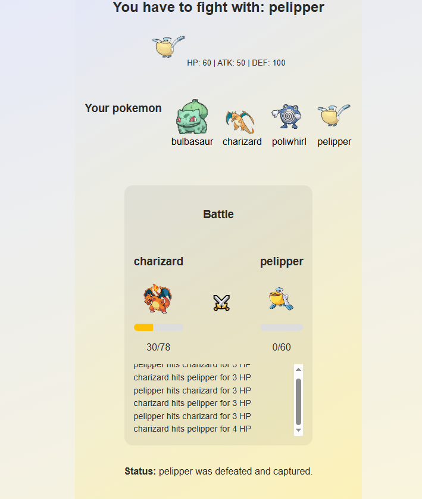
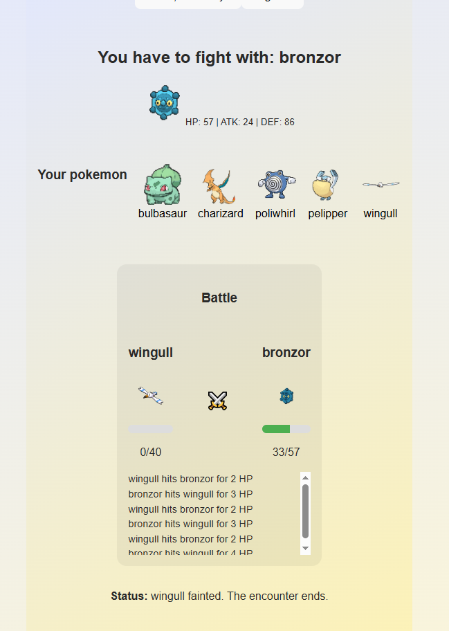

# BUG-001: Location list is not displayed after victory or defeat

- Status: Open
- Application: Gotta Fetch 'Em All — Dugtrio
- Requirement: 4.4 — After the encounter, the available locations should be shown again.

## Testing environment

| Item | Value |
| --- | --- |
| Operating system | Windows 10 Pro 22H2, build 19045.6466, x64 |
| Browser | Google Chrome 156.0.8078.80 |
| Application branch | `development` |
| Application commit | `e6796516b1d4d4d667828099e104969a9d4f1ce8` |
| Frontend URL | `http://localhost:5173/` |
| Backend URL | `http://localhost:4000` |
| Execution | Manual testing in a local development environment |

Environment versions and checkout metadata were collected on 2026-11-04
after the observations. See the [environment snapshot](../testing-environment.md)
for runtime versions, external dependencies and test data considerations.

## Preconditions

- The frontend and backend are running.
- The player is in an encounter and can select an owned Pokémon.

## Steps to reproduce

1. Select an owned Pokémon.
2. Start the battle using the **Fight!!!** button.
3. Complete the battle with either a victory or a defeat.
4. Wait without clicking any navigation buttons.
5. Observe the displayed screen.

The opponent is selected randomly. The issue has been observed on both
the victory and defeat paths; the examples below record the specific
Pokémon involved in each observation.

## Expected result

After the encounter ends, the available locations are displayed again,
as described in requirement 4.4.

## Actual result

The completed battle remains visible after both victory and defeat. The
location list does not reappear after waiting without further user interaction.

## Observed examples

### Victory

- Player Pokémon: Charizard, remaining HP: **30/78**.
- Opponent: Pelipper, remaining HP: **0/60**.
- Status: **"pelipper was defeated and captured."**
- Pelipper appears in the player's Pokémon collection.
- The battle screen remains displayed after waiting.

### Defeat

- Player Pokémon: Wingull, remaining HP: **0/40**.
- Opponent: Bronzor, remaining HP: **33/57**.
- Status: **"wingull fainted. The encounter ends."**
- Bronzor does not appear in the displayed owned Pokémon list.
- The tester confirmed that the battle log stopped updating.
- The location list did not reappear.

## Impact

The player is not returned to location selection after the encounter,
interrupting the expected exploration flow.

## Evidence

The screenshots record the final battle states. The tester additionally
confirmed that the location list did not return after waiting in either
case, and that the battle log stopped after defeat. The exact waiting
durations were not recorded.

## Reproducibility

Observed in two completed battles: once after victory and once after defeat.
Further repetitions on each path are needed to establish consistency.

## Automated coverage

This issue is supported by the manual observations above. The final
automated suite does not start a battle or check post-battle navigation.
Its passing leave-encounter scenarios cover leaving before battle or
returning from an empty location, not this defect.

## Developer communication

Not yet shared with the developers. Add the sharing date and a link to the
discussion or issue after sharing this report through the agreed channel.
