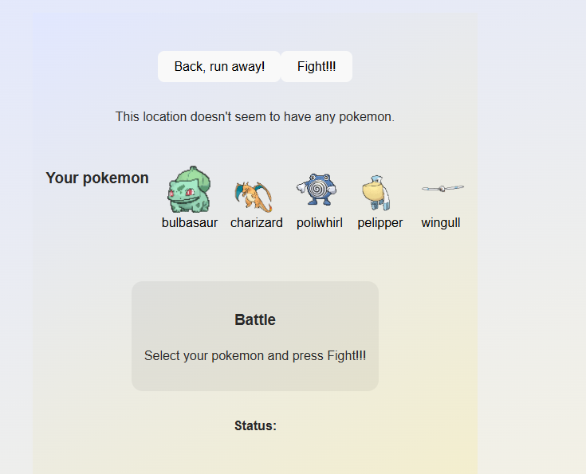

# BUG-002: No-encounter message differs from the required text

- Status: Open
- Severity: Low — text discrepancy; navigation remains available.
- Application: Gotta Fetch 'Em All — Dugtrio
- Requirement: 2.3 — Show the specified message when the location has no Pokémon encounter.

## Testing environment

| Item | Value |
| --- | --- |
| Operating system | Windows 10 Pro 22H2, build 19045.6466, x64 |
| Browser | Google Chrome 156.0.8078.80 |
| Application branch | `development` |
| Application commit | `e6796516b1d4d4d667828099e104969a9d4f1ce8` |
| Frontend URL | `http://localhost:5173/` |
| Backend URL | `http://localhost:4000` |
| Detection | Manual observation and an automated Cucumber/JUnit text assertion reported by the tester |

Environment versions and checkout metadata were collected on 2026-11-04.
See the [environment snapshot](../testing-environment.md) for details.

## Preconditions

- The frontend and backend are running.
- The location selection page is open.

## Steps to reproduce

1. Select `spring-path`.
2. Wait for the no-encounter message to appear.
3. Compare the displayed message with the exact text in requirement 2.3.

## Expected result

```text
This location doesn't seem to have any pokémon
```

## Actual result

```text
This location doesn't seem to have any pokemon.
```

The displayed word omits the accent in `pokémon` and adds a final period.

## Impact

The message communicates the no-encounter state, but does not match the
specified text. The Back button was manually confirmed to return to the
location list. No navigation failure is attributed to this text discrepancy.

## Evidence and automation



The tester confirmed that the exact-text assertion in
`LocationSteps.verifyNoEncounterMessage()` reports this difference.
The scenario is named **Display the required no-encounter message** in
`src/test/resources/features/locations.feature`.

The [archived run on 2026-11-05](../test-results/README.md) confirms the
assertion failure at **the no-encounter message should match the requirement**.
The HTML report includes the failure screenshot attached by the teardown hook.

Return navigation is checked independently in **Return from a location
without Pokemon**, which passes in the same run. The failed text assertion
does not prevent that separate scenario from executing.

## Developer communication

Not yet shared with the developers. Add the sharing date and a link to the
discussion or issue after sharing this report through the agreed channel.
