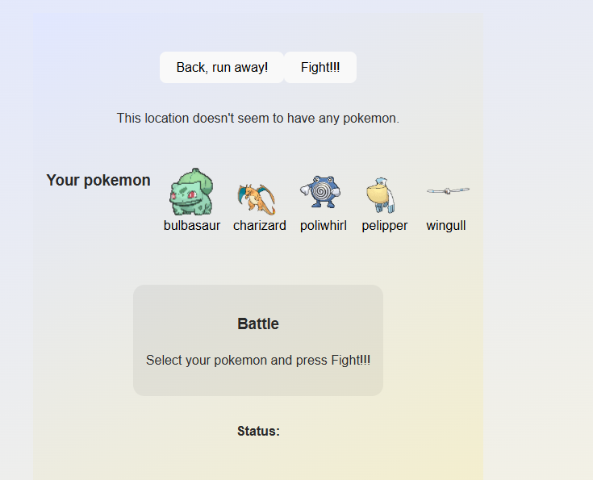
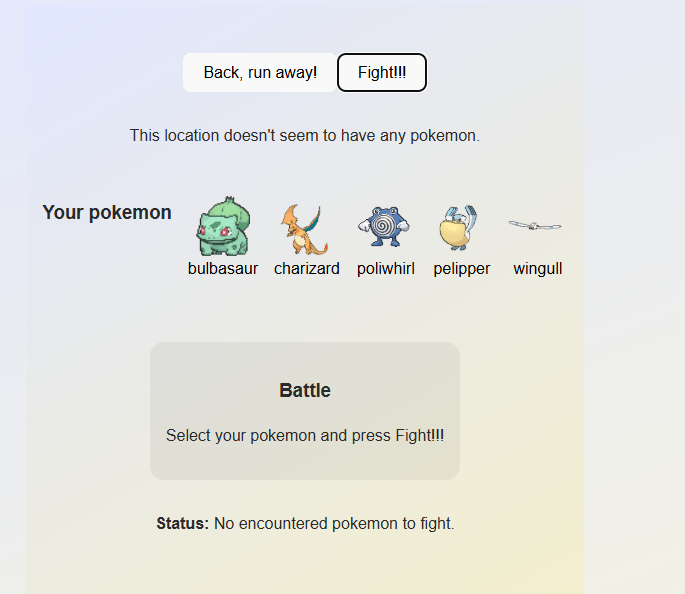

# Exploratory testing notes

## Scope and evidence

Application: Gotta Fetch 'Em All — Dugtrio.

These notes record manual observations reported by the tester during the
guided testing session, supported by supplied screenshots. They are not
independent executions by the assistant.

The application lets players choose locations, encounter Pokémon, select
owned Pokémon and battle opponents. A victory can add the opponent to the
owned collection. The frontend and backend must both be running.

The tested version is expected to remain unchanged during this testing
period, according to the tester. See the [testing environment](testing-environment.md)
for the machine, browser and checkout snapshot collected on 2026-11-04.
The elapsed exploratory testing time was not tracked; these notes do not
establish completion of the required 2–3 hour timebox.

## EXP-001: Victory and capture

- Requirement: 4.2, 4.4.
- Player Pokémon: Charizard.
- Opponent: Pelipper.
- Final HP: Charizard **30/78**, Pelipper **0/60**.
- Status: `pelipper was defeated and captured.`
- Pelipper appeared in the owned Pokémon list.
- The tester confirmed that the location list did not return after waiting.
- Result: Victory and capture were observed; return to location selection failed.
- Finding: [BUG-001](bug-reports/BUG-001-locations-not-shown-after-victory.md).
- [Screenshot](bug-reports/evidence/BUG-001-victory-screen.png).

## EXP-002: Defeat

- Requirement: 4.3, 4.4.
- Player Pokémon: Wingull.
- Opponent: Bronzor.
- Final HP: Wingull **0/40**, Bronzor **33/57**.
- Status: `wingull fainted. The encounter ends.`
- Bronzor was absent from the displayed owned Pokémon list.
- The tester confirmed that the battle log stopped updating.
- The location list did not return.
- Result: The battle ended after defeat; return to location selection failed.
- Finding: [BUG-001](bug-reports/BUG-001-locations-not-shown-after-victory.md).
- [Screenshot](bug-reports/evidence/BUG-001-defeat-screen.png).

## EXP-003: Location without a Pokémon encounter

- Requirement: 2.3.
- Location: `spring-path`.

The tester reported that `spring-path` was the only location without a
Pokémon encounter among the locations explored in this session.

### Actions

1. Select `spring-path` from the location list.
2. Observe the message displayed instead of an opponent.
3. Click **Back, run away!**.

### Observed result

The message `This location doesn't seem to have any pokemon.` was displayed.
The tester confirmed that the Back button returned to the location list.

Result: The no-encounter message and return navigation worked in this trial.
The wording differs from the requirement's exact text,
`This location doesn't seem to have any pokémon`, in the accent and final
period. This discrepancy is documented in
[BUG-002](bug-reports/BUG-002-no-encounter-message-text.md).

## EXP-004: Attempt to fight without an opponent

- Location: `spring-path`.
- Additional exploratory check; no explicit requirement specifies this status message.

### Actions

1. Open the no-encounter view for `spring-path`.
2. Click **Fight!!!**.

### Observed result

The status `No encountered pokemon to fight.` appeared. No battle was
observed to start. The page remained usable in the reported trial.

Result: The application handled the attempted action with a status message.
Whether an owned Pokémon had been selected immediately before this action
was not confirmed.

## Other findings

- [IMP-001: Display player Pokémon statistics before battle](improvements/IMP-001-player-pokemon-statistics.md).
- The inspected opponent image used a Showdown GIF URL. The requirement
  specifies `front_default`; compliance with the required sprite source
  has not been established by the existing image visibility checks.

## Automated checks reported by the tester

The tester reported successful execution of these four scenarios:

1. Display 20 locations.
2. Start an encounter by selecting a location.
3. Select an owned Pokémon before battle.
4. Return to locations without starting a battle.

An additional scenario, **Return from a location without Pokemon**, was
reported to fail at the exact no-encounter message comparison, detecting
[BUG-002](bug-reports/BUG-002-no-encounter-message-text.md). Its subsequent
navigation steps are skipped after the failure, so this run does not
verify the return navigation automatically.

These checks do not establish complete coverage of the application.
In particular, the location count check does not verify the identities
of the first 20 locations, and the exact damage formula has not yet
been verified.
